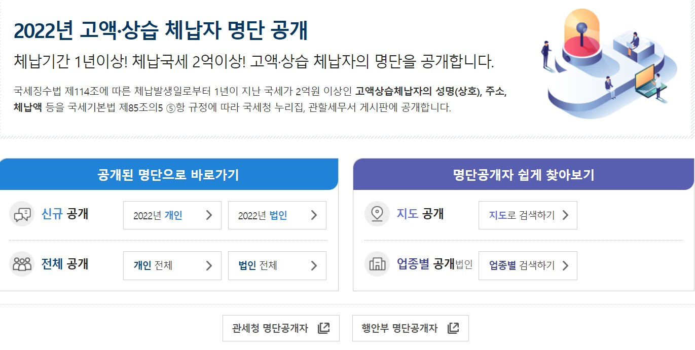

# Korea High-Value Tax Delinquency Dashboard (2012–2022)

An interactive Streamlit dashboard analyzing South Korea's publicly disclosed list of high-value, habitual tax delinquents, comparing individuals and corporations by year, region, and age group.

3-day team project (May 15–17, 2023), Woori FISA AI Engineering Bootcamp.



## Overview

Korea's National Tax Service (NTS) publicly discloses taxpayers whose national tax debt of KRW 200M or more has been overdue for over a year. We wanted to see how delinquency has changed over time and whether it is concentrated in particular regions.

Questions explored:

- How has the total delinquent amount changed from 2012 to 2022, for individuals vs. corporations?
- Which provinces, and which districts within Seoul, account for the most delinquency?
- How is delinquency distributed across age groups?

## Data

- Source: NTS high-value habitual tax delinquent data (public data)
- Coverage: 2004–2022, analyzed for 2012–2022
- Individuals: 30,462 rows × 12 columns
- Corporations: 13,835 rows × 7 columns
- Boundaries: `sido.json` (provinces), `seoulsigungu.geojson` (Seoul districts)
- Personal identifiers (names, representatives, detailed addresses) were dropped during preprocessing; the repository contains aggregated tables only.

## Data Processing

1. Split the data into individual and corporate datasets and analyzed them separately.
2. Dropped columns not needed for the regional analysis (name, representative, industry, tax type, case count, etc.).
3. Parsed the address field into province and city/district columns.
4. Built a reusable `groupby` function returning, per key (year or region), the total delinquent amount, the number of delinquents, and the average amount per delinquent.
5. Saved aggregated tables (`df_year.csv`, `df_com_loc*.csv`, `df_per_loc*.csv`, `df_map_sum.csv`, etc.) for the dashboard.

## Key Findings

- In 2016, the number of disclosed delinquents jumped about 5x (844 → 4,028 corporations) while the average amount per delinquent roughly halved. This matches the 2016 amendment that lowered the disclosure threshold from KRW 500M to KRW 300M: the spike reflects a change in the disclosure rule, not a sudden rise in delinquency.
- Gyeonggi-do and Seoul account for the largest share of delinquent amounts, for both individuals and corporations.
- Within Seoul, Gangnam-gu shows the highest concentration of delinquent amounts.
- In 2022, individuals in their 50s made up the largest share of delinquents (about 37%), followed by those in their 40s and 60s.

## Dashboard

- Main: yearly trend of total delinquent amount, individuals vs. corporations
- Individuals: age group pie chart, treemap by province, Seoul district choropleth
- Corporations: treemap by headquarters location, Seoul district choropleth
- Nationwide bubble map (square-root scaling so differences are visible)

## Tech Stack

Python, pandas, Plotly, Matplotlib, Seaborn, Streamlit, GeoJSON

## How to Run

```bash
pip install -r requirements.txt
streamlit run mainpage.py
```

## Limitations

The data includes many categories (industry, tax type) that we did not have time to clean and analyze within the 3-day timeline. A next step would be breaking delinquency down by industry and tax type.

## Team & My Role

Team "Bujadoegosipjo" (Want-to-be-Rich): Mirim Woo, Haejung Jung, Minhee Lee, Joohyuk Lee

My contributions: address parsing, aggregation function, data cleaning
